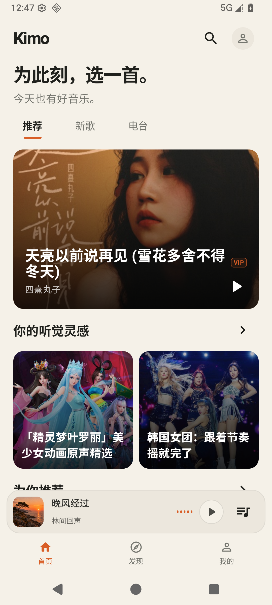
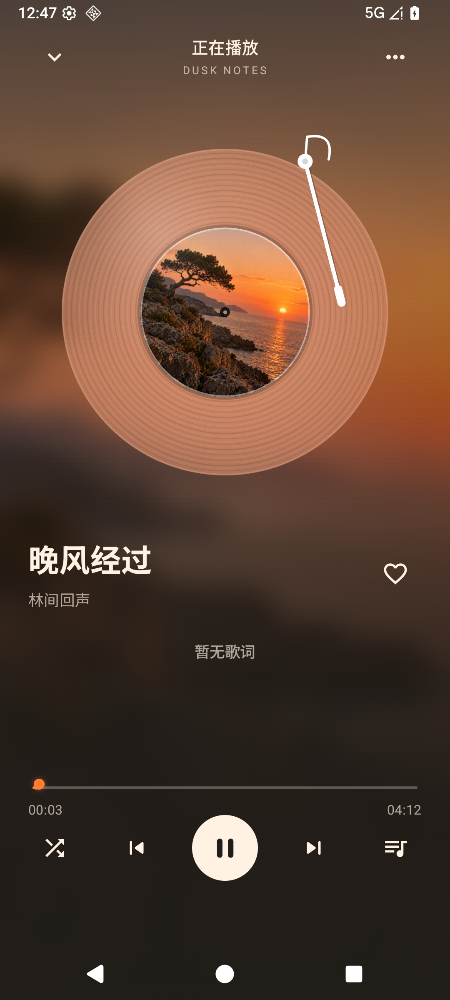
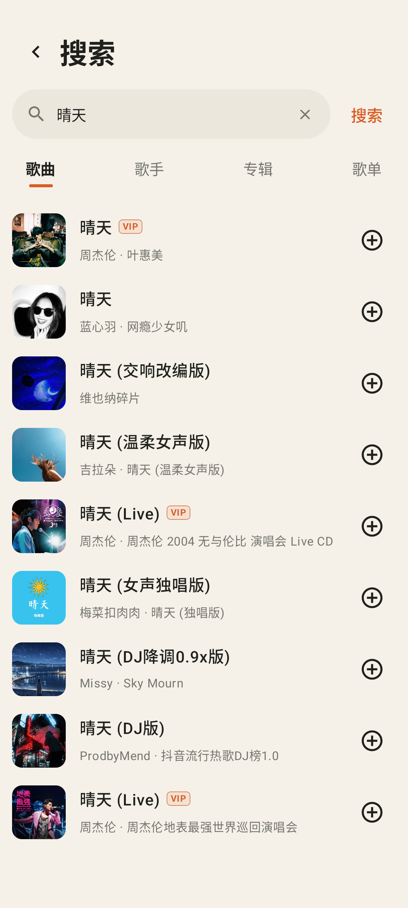
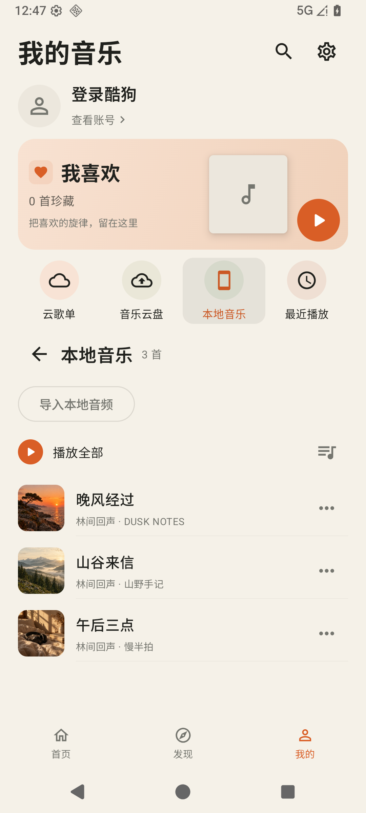
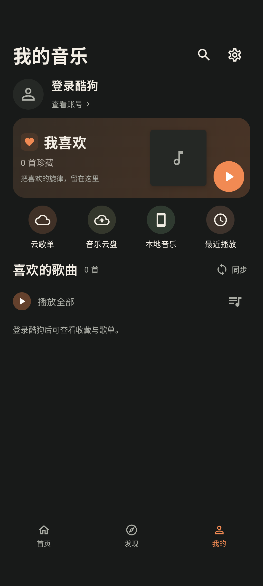
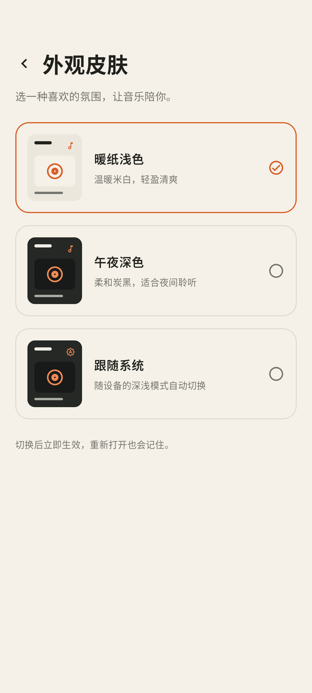
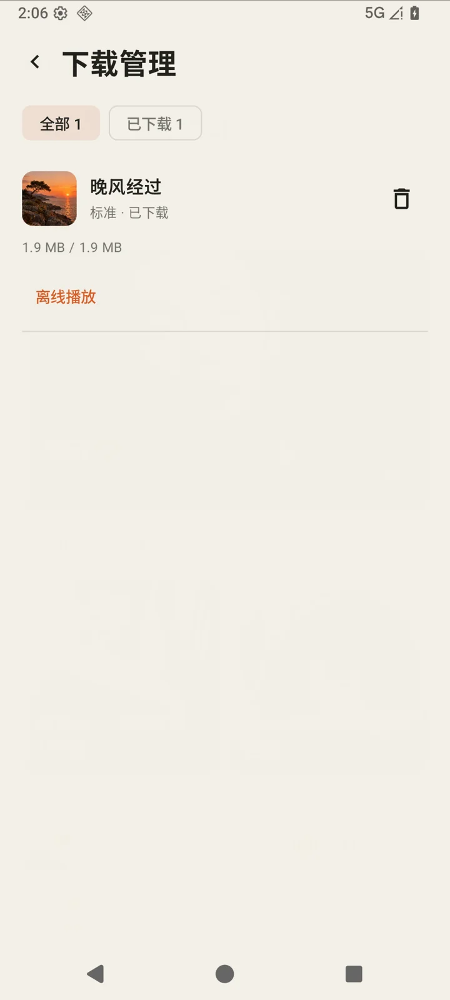
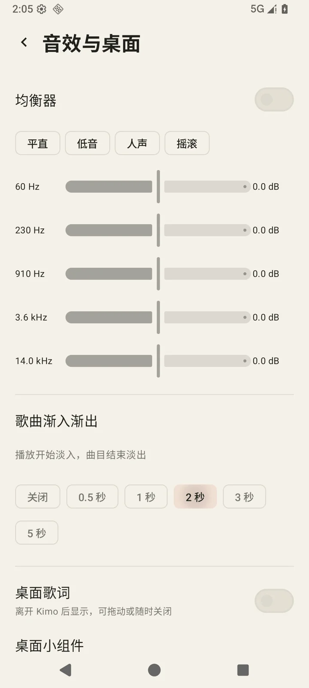
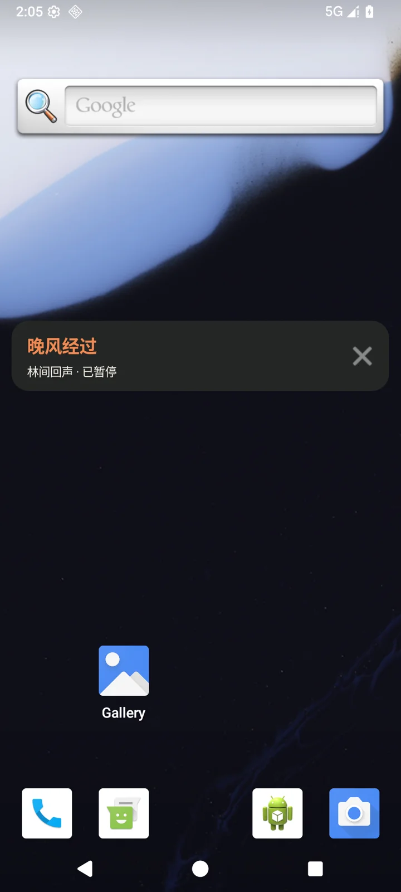

# Kimo Android

原生 Android 音乐客户端，支持在线曲库、离线下载、本地音频、云端收藏与深浅主题。

  

Kimo 使用 Kotlin、Jetpack Compose 和 Media3 构建界面与播放器，通过 Javet 在手机进程内运行音乐接口核心。安装后可独立使用，无需连接电脑或另行部署 API 服务。

[下载安装包](https://github.com/kimo-si/kimo-music-android/releases/latest) · [更新日志](CHANGELOG.md) · [界面预览](#界面预览) · [功能特性](#功能特性) · [安装与使用](#安装与使用) · [本地构建](#本地构建) · [开发与测试](#开发与测试) · [常见问题](#常见问题)

## 界面预览

<table>
  <tr>
    <th>首页推荐</th>
    <th>彩胶播放器</th>
    <th>在线搜索</th>
  </tr>
  <tr>
    <td></td>
    <td></td>
    <td></td>
  </tr>
  <tr>
    <th>我的音乐</th>
    <th>午夜深色</th>
    <th>外观皮肤</th>
  </tr>
  <tr>
    <td></td>
    <td></td>
    <td></td>
  </tr>
  <tr>
    <th>下载管理</th>
    <th>音效设置</th>
    <th>桌面歌词</th>
  </tr>
  <tr>
    <td></td>
    <td></td>
    <td></td>
  </tr>
</table>

截图来自模拟器中的实际界面。播放器与本地曲库使用测试用合成音频，正式应用不预置这些曲目；在线推荐和搜索内容随平台返回变化。

## 功能特性

| 功能 | 说明 |
| --- | --- |
| 在线发现 | 推荐歌单、新歌、排行榜、热门歌手、电台，以及对应曲目和详情页 |
| 分类搜索 | 搜索歌曲、歌手、专辑和歌单；支持输入联想、搜索历史、实时热搜与分页 |
| 音乐播放 | 迷你播放条与完整播放器共享队列，支持进度拖动、切歌、随机、顺序和循环播放 |
| 播放恢复 | 保留队列、当前歌曲、进度、随机 / 循环模式、音量与音质；重新打开时恢复为暂停状态 |
| 队列编辑 | 下一首播放、长按手柄拖动排序、移除歌曲与确认清空；保留当前曲目与收藏 |
| 离线下载 | 后台任务、字节进度、暂停 / 继续 / 重试、删除与离线播放；验证服务端实体一致后才续传 |
| 本地整理 | 歌曲 / 歌手 / 专辑 / 文件夹分组、搜索、多选收藏、移除导入记录与失效文件检查 |
| 播放动效 | 随封面取色的彩胶唱片、播放波形、播放器展开转场，以及播放前完整的 1.06 秒音符飞入动画 |
| 同步歌词 | 在线 LRC、逐行高亮与平滑过渡，支持自动滚动、点击歌词跳转和失败重试 |
| 账号与收藏 | 手机号验证码 / 二维码登录，同步我喜欢与云歌单；收藏立即更新爱心，写入确认后反馈结果 |
| 云歌单管理 | 创建、重命名、删除或取消收藏歌单，向歌单添加当前歌曲，读取完整分页曲目 |
| 我的音乐 | 登录前后统一的黑胶账号卡、离线入口、收藏预览与云歌单入口；各栏目独立保留滚动位置 |
| 本地音乐 | 多文件导入、元数据与内嵌封面读取、本机收藏、最近播放及持久文件访问权限 |
| 音质与权益 | 标准、高品、无损音质；根据账号实际权益取流，并核实歌曲的 VIP 标识 |
| 主题外观 | 暖纸浅色、午夜深色和跟随系统；设置、登录、弹层及全局提示统一适配 |
| 后台播放 | 系统媒体通知、锁屏控制、音频焦点、耳机拔出暂停，以及 15–90 分钟定时停止 |
| 音效设置 | 按设备实际频段提供均衡器与预设；支持 0.5–5 秒淡入淡出，可完全关闭 |
| 桌面功能 | 可拖动、可关闭的桌面歌词，以及展示曲目和控制播放的小组件 |
| 错误恢复 | 播放失败保留队列，提示中可直接重试或前往登录，也可切到下一首 |
| 版本更新 | 关于页面显示版本、检查 GitHub 稳定更新与更新日志，按设备架构打开安装包 |
| 音频保存 | 通过系统文件选择器，保存本地音频或当前账号有权取得的在线音频 |

VIP 标识只依据资源接口返回的标准音质权益，并逐首匹配音频与专辑。无法确认、单独购买或仅高音质受限的歌曲不会被直接标成 VIP。未登录播放已确认的 VIP 歌曲时，会提示先登录；登录后的可播性仍由平台实际权益决定。

## 安装与使用

### 运行要求

- Android 8.0（API 26）及以上。
- 64 位 ARM 手机，或 x86_64 Android 模拟器。
- 在线曲库、登录和云端同步需要网络；已导入与已完成下载的音频可以离线播放。

从 [GitHub Releases](https://github.com/kimo-si/kimo-music-android/releases/latest) 下载最新 APK，也可以按照[本地构建](#本地构建)自行生成。发布页附有各架构安装包、更新说明与 SHA-256 校验值。

### 选择安装包

Release 构建产物位于 `app/build/outputs/apk/release/`：

| 文件 | 适用设备 |
| --- | --- |
| `app-arm64-v8a-release.apk` | 常见的 64 位 ARM Android 手机 |
| `app-x86_64-release.apk` | x86_64 Android 模拟器 |
| `app-universal-release.apk` | 同时包含以上两种架构 |

将 APK 发送到手机安装，或连接设备后执行：

```bash
adb install -r app/build/outputs/apk/release/app-arm64-v8a-release.apk
```

### 首次使用

1. 在「首页」或「发现」浏览在线内容，也可以通过搜索查找歌曲。
2. 点击歌曲后，音符飞入播放条；点击底部播放条进入完整播放器。
3. 在「我的 → 设置 → 账号信息」登录酷狗账号，同步收藏与云歌单。
4. 在「我的 → 本地音乐」导入设备中的音频；在「设置 → 外观皮肤」切换主题。
5. 长按在线歌曲选择「下载音频」，在「我的 → 下载管理」查看任务与离线曲目。
6. 在「设置 → 本地曲库」搜索、分组或批量整理；移除导入记录会保留原始文件。
7. 在「设置 → 音效与桌面」调节均衡器、渐入渐出、开启桌面歌词或添加小组件。
8. 在「设置 → 关于 Kimo」查看版本、更新日志与安装包。

## 本地构建

### 环境准备

| 工具 | 要求 |
| --- | --- |
| JDK | 17；当前编译目标为 Java 17 |
| Android SDK | Android 36，含 Platform Tools 与构建工具 |
| Node.js | 已使用 Node.js 22 验证；用于安装构建时的核心依赖 |
| npm、Git | 安装锁定的 Node 依赖及 Git 来源依赖 |
| Python | Python 3，需提供 `python3` 命令，用于打包嵌入式核心 |
| Gradle | 使用仓库自带的 Gradle Wrapper，无需单独安装 |

可以使用支持本项目构建配置的 Android Studio 打开仓库。首次构建需要访问 npm、GitHub、Google Maven、Maven Central 和 Gradle 分发站点。

### 获取源码与依赖

```bash
git clone https://github.com/kimo-si/kimo-music-android.git
cd kimo-music-android
npm ci --omit=dev --prefix CoreRuntime
```

通过 Android Studio 配置 SDK 路径；仅使用命令行时，也可以在仓库根目录创建 `local.properties`：

```properties
sdk.dir=/absolute/path/to/Android/sdk
```

`local.properties`、依赖目录、构建输出和签名文件均已加入 Git 忽略规则。

### 构建 APK

```bash
# 开发调试包
./gradlew :app:assembleDebug

# Release 安装包
./gradlew :app:assembleRelease
```

Windows 下将 `./gradlew` 替换为 `gradlew.bat`。Debug 产物位于 `app/build/outputs/apk/debug/`，文件名中的构建类型为 `debug`。

当前 Release 配置使用本机的 Debug 签名。覆盖安装必须使用相同签名；不同电脑生成的签名可能不同。签名密钥不包含在仓库中。

### 核心如何进入 APK

构建任务会自动执行 `tools/package_core.py`，将锁定的 Node 依赖、`CoreRuntime/device.mjs` 与安卓桥接文件打包为应用资源。应用通过 Javet 在专用工作线程运行核心，直接调用接口模块，不开放本地 HTTP 监听端口。

依赖由 `CoreRuntime/package-lock.json` 锁定。电脑端设备数据、账号数据、Git 元数据及电脑专用原生插件不会被打进 APK；手机端会独立保存设备标识和登录会话。

## 开发与测试

### 基础检查

```bash
# Kotlin 单元测试与 Android Lint
./gradlew :app:testDebugUnitTest :app:lintDebug

# Node 桥接层回归
node --test tools/kugou_bridge.test.cjs
```

### 设备测试

连接专用测试模拟器后运行：

```bash
./gradlew :app:connectedDebugAndroidTest
```

设备测试覆盖真实公开曲库、搜索、账号入口、VIP 识别、本地音频播放、后台媒体会话、收藏同步、歌词动效和主题；同时验证服务重建后的恢复、真实长按队列排序、下载续传文件完整性、缓存播放、均衡器读回、淡入淡出音量、系统小组件和歌词悬浮窗。部分测试依赖在线接口。

请使用专用测试设备：测试包含本地会话清理，Gradle 设备测试也可能重新安装应用。测试不会发送短信、代替用户扫码授权或写入真实账号的云端数据。

<details>
<summary>验证 Release 安装包</summary>

```bash
./gradlew -PkimoTestBuildType=release \
  :app:assembleRelease :app:assembleReleaseAndroidTest \
  :app:testReleaseUnitTest :app:lintRelease

adb install -r app/build/outputs/apk/release/app-arm64-v8a-release.apk
adb install -r app/build/outputs/apk/androidTest/release/app-release-androidTest.apk
adb shell am instrument -w -r \
  com.kimo.music.android.test/androidx.test.runner.AndroidJUnitRunner
```

以上安装命令适用于 ARM64 设备；x86_64 模拟器需换成对应架构的主应用 APK。连接多个设备时，为 `adb` 命令加上 `-s <设备序列号>`。

</details>

## 项目结构

```text
kimo-music-android/
├── app/src/main/
│   ├── java/com/kimo/music/
│   │   ├── core/           # 嵌入式核心、接口映射、登录、分页与云端同步
│   │   ├── data/           # 曲目模型、本地音频与持久化
│   │   ├── downloads/      # 下载任务、断点续传、离线文件与前台服务
│   │   ├── widget/         # 系统桌面小组件
│   │   ├── playback/       # 取流、Media3 服务和播放状态
│   │   └── ui/             # 页面、播放器、主题与通用组件
│   ├── res/                # Android 资源
│   └── AndroidManifest.xml
├── app/src/test/            # JVM 单元测试
├── app/src/androidTest/     # 设备测试与独立测试资源
├── CoreRuntime/             # 核心依赖声明、锁文件与设备标识模块
├── tools/                   # 核心打包、桥接与测试音频生成工具
└── docs/screenshots/        # README 使用的实际界面截图
```

正式应用不预置演示歌曲或用户资料。测试音频和图片仅位于 `androidTest` 中；重建合成音频可运行 `python3 tools/generate_demo_audio.py`，该工具额外需要 `numpy` 与 `ffmpeg`。

## 账号与数据

- 登录凭据通过 Android Keystore 管理的 AES-GCM 密钥加密保存；退出登录后清除凭据与界面中的账号曲库。
- 云端收藏和歌单快照按账号隔离保存，不缓存临时播放地址。刷新失败时保留已有列表。
- 本地文件通过系统文件选择器授权访问，导入时读取歌曲自身的元数据与封面；曲库整理只移除导入记录。
- 下载文件保存在应用专用目录，删除下载仅清理对应任务和应用管理的文件；卸载应用会删除这些文件，需要外部保留时可使用「另存为文件」。
- 下载和播放均遵循账号实际权益。任务索引不保存临时播放链接、签名 URL 或账号凭据。
- 桌面歌词仅在用户开启并授权悬浮窗后显示；关闭按钮可随时停用。通知权限在首次下载时请求。
- 在线收藏会写入酷狗账号。爱心立即响应，写入失败时回滚；写入成功但列表刷新失败时保留已提交状态并提示重新同步。

## 常见问题

### VIP 歌曲登录后一定能播放吗？

不一定。登录用于识别当前账号，歌曲能否播放及可用音质仍取决于平台返回的账号权益、版权和安全验证结果。应用不会绕过这些限制。

### 为什么首次打开本地音乐是空的？

应用不附带音乐文件。请在「我的 → 本地音乐」导入音频；在线收藏和云歌单需要登录后同步。

### 为什么均衡器暂时不可用？

请先播放一首歌曲，建立真实音频会话。均衡器频段、增益范围与可用性由 Android 音效设备决定；不支持或被其他应用占用时，页面会给出说明。

### 渐入渐出是什么效果？

开启后在播放开始时淡入，在曲目自然结束前淡出；时长可选 0.5–5 秒。这一版本使用单播放器音量包络，不提供两首歌曲重叠混音。

### 下载暂停后一定能从原位置继续吗？

服务端支持范围请求，且实体标识与本地片段一致时可以续传。资源发生变化、无法验证一致性或不支持范围请求时，会重新下载以避免文件损坏。已完成文件会先通过音频解析校验，再进入离线列表。

### 音乐云盘是否可用？

当前尚未提供可操作的音乐云盘页面，新总览不展示这一未开放入口。

### 为什么部分封面、歌词或在线列表加载失败？

这些内容依赖平台接口和 CDN。可以检查网络并使用页面上的重试或同步入口。没有可靠封面时显示中性音符占位，没有歌词时显示实际空状态。

### 为什么无法覆盖安装？

请检查 APK 架构和签名。覆盖安装要求与已安装应用使用相同签名；自行构建的 APK 可能与其他电脑生成的版本签名不同。

## 参与贡献

欢迎通过 [Issues](https://github.com/kimo-si/kimo-music-android/issues) 反馈问题或提出建议，也欢迎提交 Pull Request。

反馈问题时，请提供应用版本、Android 版本、复现步骤和截图，并移除手机号、验证码或登录凭据。提交代码前请运行相关检查；界面调整请附上实际截图。

## 致谢与许可

- [KuGouMusicApi](https://github.com/MakcRe/KuGouMusicApi)：音乐接口核心。
- [MoeKoeMusic](https://github.com/MoeKoeMusic/MoeKoeMusic)：设备标识模块的参考来源。
- [Javet](https://github.com/caoccao/Javet)：Android 中的 JavaScript / Node.js 运行时支持。
- [Android Jetpack](https://developer.android.com/jetpack)、[Media3](https://developer.android.com/media/media3) 与 [Coil](https://github.com/coil-kt/coil)：界面、媒体播放与图片加载。

仓库目前尚未声明项目级开源许可证。第三方依赖遵循其各自许可证，嵌入式依赖中的许可证文件随核心包保留。
